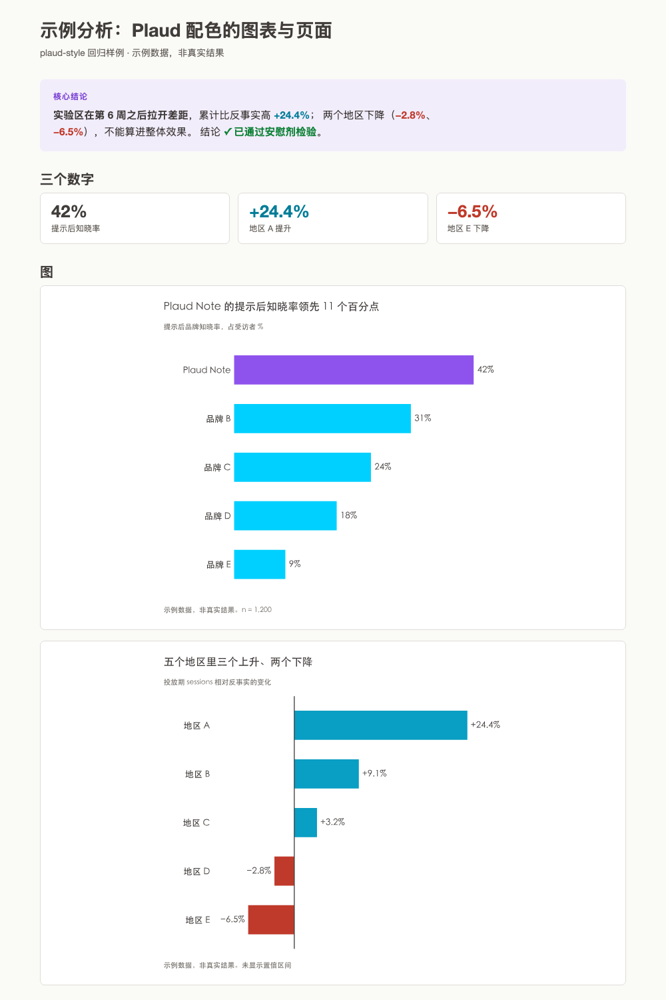
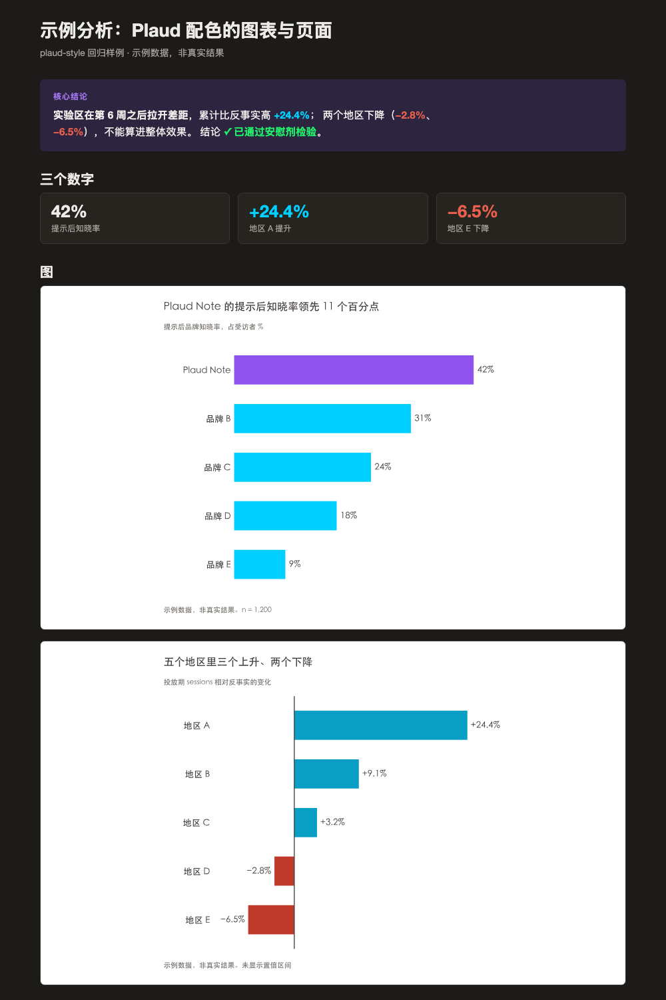

<h1 align="center">plaud-style</h1>

<p align="center">
  <strong>Plaud's visual standard for internal analysis: charts and HTML pages</strong><br>
  <sub>Claude Code skill · chart_theme.py and base.css also work standalone</sub>
</p>

<p align="center">
  <strong>English</strong> · <a href="../README.md">中文</a>
</p>

---

## Preview

<p align="center">
  
</p>

<details>
<summary>Dark mode</summary>

<p align="center">
  
</p>

</details>

The sample page is generated by `demo.py`; its data is fictional.

---

## Where this comes from

The palette is Plaud's brand colors: Victory Purple, Clarity Blue, Amplify Green. The chart theme and page styles used to live in two research projects, one copy each.

This skill does three things: **lifts them out of those projects into one standard shared by every analysis; fills in what the brand palette lacks (a negative color and rules for series); and checks every color with dataviz's validation script.**

---

## Why it exists

Palettes passed around as copied files drift. One project turned up four mutually inconsistent "styles," only one of which was ever really used. Every new analysis meant hunting for the file and asking again what our colors are.

The palette has a second problem. Of the three brand hues, blue and green are too light (1.8:1 and 1.5:1 on white), so thin lines and text in those colors are hard to read. And there is no negative color, so the first time an analysis shows a decline, everyone invents their own red.

These rules don't solve an aesthetic problem. They solve a **consistency and legibility** problem: one color means the same thing in every analysis, each color has been checked for contrast and for separation under color-vision deficiency, and the rules are written down instead of remembered.

---

## How it works

When an AI gets a request for a chart or a page, this skill supplies the palette and the rules, plus code it can call directly:

| File | Purpose |
|---|---|
| `SKILL.md` | Palette table, 12 rules, validation log (the single source of truth for color values) |
| `chart_theme.py` | matplotlib theme; three ready-made chart types `ranking_bar` / `lift_bars` / `trend_lines`; ordinal, sequential, and diverging color ramps |
| `base.css` | Page styles: light and dark, key-finding block, cards, tables, badges, `.chart-frame` |
| `page.py` | Wraps body HTML in the styles; outputs a self-contained page or an Artifact fragment |
| `demo.py` | Regression sample |

Use it alongside `dataviz` (chart method) and `artifact-design` (page contract): follow them for method, and take colors from this skill.

---

## Color Palette

| Role | Value | Used for |
|---|---|---|
| Emphasis · series 1 | Victory Purple `#8F53ED` | Focal brand, headline finding |
| Default comparison · series 2 · positive polarity | Clarity Blue `#00D0FF` (`#099EC3` for lines and points) | Standard series, increases |
| Confirmed · series 3 | Amplify Green `#21EF6A` (`#03A745` for lines and points) | Passed or confirmed, always with ✓ or text |
| Negative | `#C03A2B` | Decreases, below baseline |
| De-emphasis | Deep Black `#000000` | Items that matter less |
| Other / reference | `#8C8883` | Series folded into Other, appendix distributions |
| Text, axes | `#413D3B` | |
| Borders | `#E0DDD9` | |
| Page background | `#FAFAF7` | |

The brand blue and green are for large fills only (wide bars, color blocks, badge backgrounds) and need value labels. Lines, points, and thin bars always use the darkened mark colors. Full values, including dark mode and text colors, are in `SKILL.md`.

---

## Key Rules

| # | Rule |
|---|---|
| 1 | One chart, one conclusion: write the title as a conclusion ("A leads by 11 points"), not "Distribution of A" |
| 2 | Nominal categories: all bars share the default color; only the named one gets purple |
| 3 | At most 3 series (purple, blue, green, in fixed order); fold the rest into a gray Other or split into small charts; never generate a fourth color |
| 4 | Ordered data takes an ordinal ramp, magnitude a sequential ramp, polarity blue ↔ red; order and polarity never rely on color alone, so add position or a signed value |
| 5 | Text never takes a series color |
| 6 | Green means "confirmed" only, never polarity; red and green are never the sole distinction (only ΔE 8 apart under color-vision deficiency) |
| 7 | No dual axes; with two or more series, show both a legend and direct labels at the line ends |
| 8 | Charts are designed for a light surface; in HTML, wrap them in `.chart-frame` so they stay visible on dark pages |
| 9 | Fictional or placeholder data must be labeled "sample data" |

All 12 rules are in `SKILL.md` (written in Chinese).

---

## Ready-Made Chart Types

```python
import sys, os
sys.path.insert(0, os.path.expanduser("~/.claude/skills/plaud-style"))
from chart_theme import *

apply_theme("en")            # "en" for Latin-only labels; use "zh" when labels contain Chinese or Japanese
set_output_dir("charts")
fig, ax = ranking_bar(["A", "B", "C"], [42, 31, 24], highlight="A", fmt="{:.0f}%",
                      headline="A leads by 11 points", caption="n = 1,200")
save_chart(fig, "ranking")   # -> charts/ranking.svg
```

For pages, `render_page()` / `write_page()` in `page.py` wrap body HTML in `base.css`. To publish as an Artifact, use `render_page(..., for_artifact=True)`.

---

## Validation

Colors were checked with dataviz's `validate_palette.js` (2026-10-12):

| Check | Result |
|---|---|
| Mark colors `#8F53ED,#099EC3,#03A745`, light mode, all pairs | Pass; worst-case color-vision-deficiency ΔE 12.9, normal vision 18.8 |
| Same, dark mode | Pass |
| Diverging pair `#C03A2B` ↔ `#099EC3` | Pass; color-vision-deficiency ΔE 20.4 |
| Ordinal ramps, 3 / 5 / 7 steps, all three hues | Pass |
| Brand blue and green used directly as lines | Fail (contrast 1.8:1 and 1.5:1), hence the mark colors |

---

## Install

Send this link to your AI agent and it will handle the setup:

👉 https://github.com/ctbai163-maker/plaud-style

This is a private repository: you need an invitation as a collaborator and a logged-in GitHub session (`gh auth login`, or configured git credentials).

**Claude Code**
```bash
git clone https://github.com/ctbai163-maker/plaud-style.git ~/.claude/skills/plaud-style
```
Restart your session after installing so the skill shows up in the list. Update later with `git -C ~/.claude/skills/plaud-style pull`.

**Any other AI / without skills**

Copy `chart_theme.py`, `base.css`, and `page.py` into your project, then add the "规则" (Rules) section of `SKILL.md` to your project rules file (`CLAUDE.md` / `AGENTS.md` / system prompt).

### Requirements

- Python with matplotlib (`pip install matplotlib`), for charts
- The `dataviz` skill (bundled with Claude), for rerunning validation after you change colors; not needed for everyday charting

Try it: `python3 ~/.claude/skills/plaud-style/demo.py /tmp/plaud-demo`, then open `/tmp/plaud-demo/demo.html`.

---

## Changing Colors

The palette table in `SKILL.md` is the single source of truth. When you change a color, update the same hex values in `chart_theme.py` and `base.css`, rerun the commands in the validation section of `SKILL.md`, and finish with `demo.py` to check light and dark.

---

## Credits

Palette: Plaud's brand colors. Chart theme and page styles: generalized from the versions in two internal research projects. Color validation method: the `dataviz` skill bundled with Claude.  
Maintained by [@ctbai163-maker](https://github.com/ctbai163-maker).
